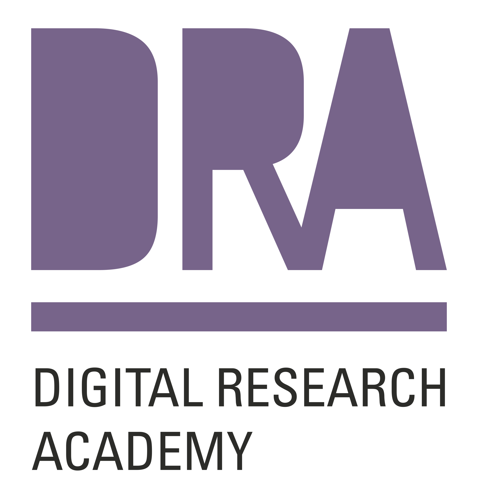
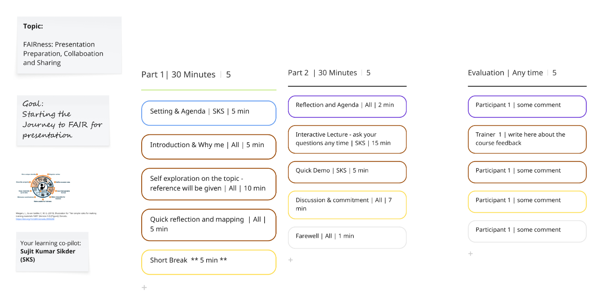
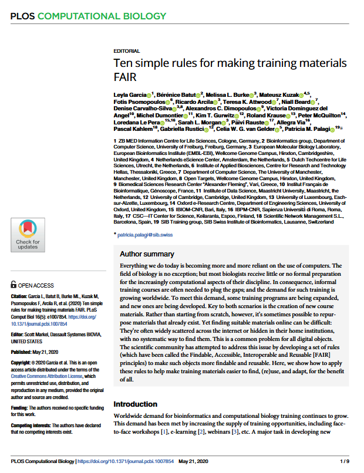
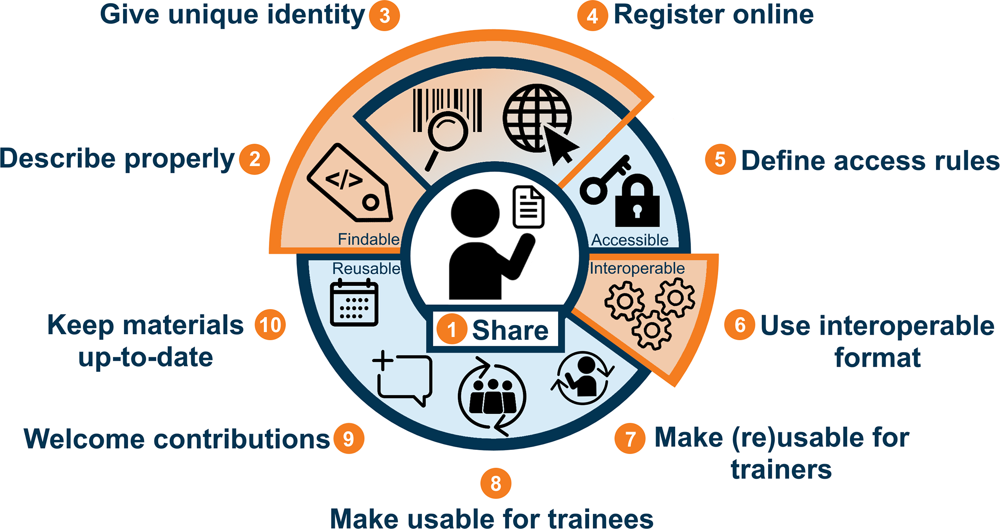
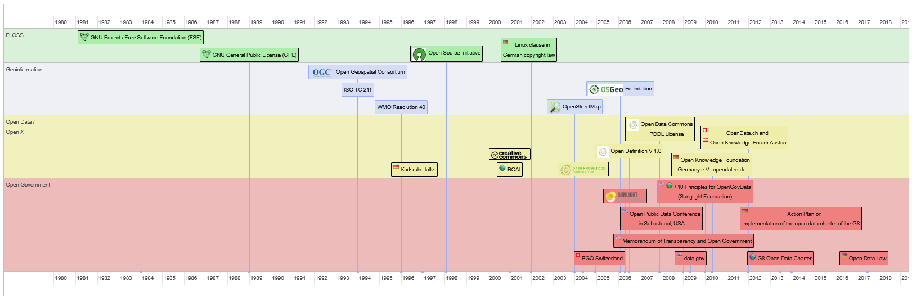
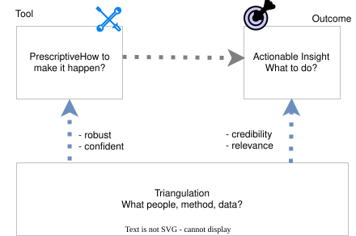
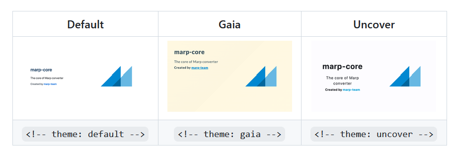
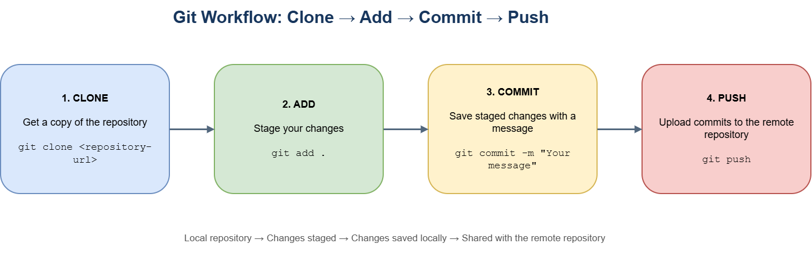
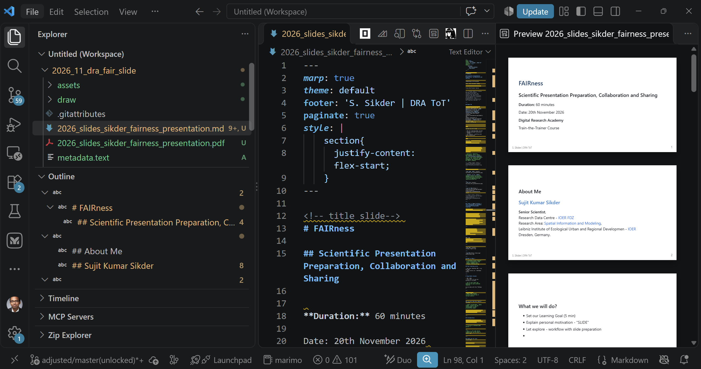

<!-- title slide--> 


# __FAIRness__

> Presentation  Preparation, Collaboration and Sharing 


### Duration:** 60 minutes

### Date: 20th November 2026 

### Prepared for: DRA ToT session



<!--DRA logo source--https://drive.google.com/drive/folders/1JzXhbG5aFwlEAJYwSk3nFDOYfBXUI49i)-->


---



---

# __Sujit Kumar Sikder__

> Academic background in spatial planning, working with geoinformation

**Senior Scientist**, 
Research Data Centre - [IOER FDZ](https://ioer-fdz.de)
Research Area: [Spatial Information and Modeling](https://www.ioer.de/en/research/spatial-information-and-modelling),
Leibniz Institute of Ecological Urban and Regional Development - [IOER](https://www.ioer.de) 
Dresden, Germany. 


### Freelance Trainer at __Academy for International Cooperation (AIZ) | GIZ__

--- 

# Why do we need to learn on this topic? 

<!--- Webslide Alex: https://slides.ad.ioer.info/haclathon-presentation/#/
-->


---

 

> Wilkinson, Dumontier, Aalbersberg, et al. (2016), The [FAIR Guiding Principles](https://doi.org/10.1038/sdata.2016.18) for scientific data management and stewardship. Sci Data 3, Nature.

<!-- Image Credit: https://commons.wikimedia.org/wiki/File:FAIR_data_principles.svg -->

---

# Tell us your story?

---

## Garcia L, Batut B, Burke ML, Kuzak M, Psomopoulos F, Arcila R, et al. (2020) __Ten simple rules for making training materials FAIR.__ PLoS Computational Biology 16(5): e1007854. [DOI](https://doi.org/10.1371/journal.pcbi.1007854)



---
# FAIRness Wheel



[Wiegers et al. (2019)](https://doi.org/10.5281/zenodo.3593257)

---


---
# PART 2
---


---

 

<!--Image credit: (https://libraries.mit.edu/app/uploads/sites/4/2020/11/FAIRNotOpen-e1604960355240.png) -->

---

# Trend in [Open X](https://learn.opengeoedu.de/opendata/vorlesung/hintergruende/timeline)



---
## Not only FAIR - [CARE Principles](https://www.gida-global.org/care) for Indigenous Data Governance


---

## Our data (digital objects): **FAIR**
## We should: **CARE**
## User can: **TRUST**
## Let's be **OPEN**, if Possible
## Why not __ELSA__ (Ethical, Legal and Social Aspects)

---



---

# PATHWAYS

## 1. PREPARE + SHARE
## 2. PREPARE + SHARE +  COLLABORATE 

---


---

# WHAT IS __MARP__ ?
 
 > A Markdown-based framework
 
 - Create presentation slides
 - Human-readable text for both people and machines
 - Highly interoperable 


---
# WHAT IS __MARKDOWN__ ?


```text 
Example: Text

# Heading 1
## Heading 2

Example: Image


Example: Web content


```
file format `.md` 


---
# WHAT ABOUT __LEARNING CURVE__ ?

- Use your favourite IDE - for example, VS Code
- Basic skills in **Markdown syntax**

> We can be artists with some  skills: `HTML`  `css` syntex

---

# EXPORTABLE FORMATS

> `.md` -export to - 
>> PDF
>> HTML

### Also PPTX __if you miss it so much - your drug__

---
# READY TO SHARE

## Now, if you want to __share__ all the presentation materials, use a preferred repository (best practice)

> Conforming to curation policies and requirements

Presentation (local)
> Version control - `git` (release)
>> FAIR publication repository - `Zenodo` 

---

# REUSABILITY | REPRODUCIBILITY | REPLICABILITY

- Keep slide content, structure and styling in version control.
- All content is an object that can be tracked.

> A good practice is to keep your input digital objects (keep metadata and citations)  including documentation at the same location
> - for example figure sources (`draw.io`  files) and code books, if possible
> - citations as  `.bibtxt`


---

# COMMENT - I do not like the default styles

> Customise - themes, layouts and web technologies to meet presentation needs.




> Start minimal `.default`; try to customize if you really know what you are doing.

---

# We are done with the __Pathway 1__


--- 

# COLLABORATION

#### Share source files and track changes in a __Git-based workflow__, e.g., CI/CD.




---
# __GIT__ IS COMPLEX !!

> I am not a software or code person!
> I am a software person - Marp has a CLI too :)

### It can help if collaborators clearly define __roles__ and have complementary __skills__

---
<!-- _class: invert -->



# QUICK DEMO

---


# ARE THERE ANY ALTERNATIVES?

- [Quarto](https://quarto.org/)
- [Slidev](https://sli.dev/)
- [reveal.js](https://revealjs.com/)
- [Remark.js](https://remarkjs.com/)
- [Presenterm](https://github.com/mfontanini/presenterm)

---
# COMMITMENT AND REFLECTION


## What is __one change__ you will make to your __next presentation__ to improve its FAIRness?

## Which pathway will you follow from tomorrow: __Pathway 1__ or __Pathway 2__?


---
# Thank you for your attention!


 [ORCiD](https://orcid.org/0000-0002-0265-7394)  
 [LinkedIn](https://de.linkedin.com/in/sujit-sikder-a4971523)

Website: https://ssujit.github.io


